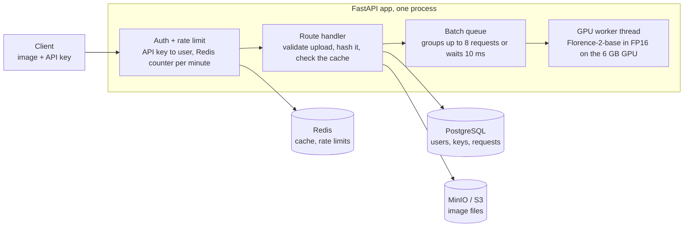

# Project 1 Design Doc: Image Model Serving Platform (VisionServe)

Oct 16, 2026

## Overview and how to learn with Claude Code

You will build **VisionServe**: a GPU-backed API that captions, reads text from (OCR), and tags images, with auth, storage, batching, caching, rate limiting, tests, Docker and CI. Target: about 6 weeks at 10 to 15 hours a week, on an RTX 3060 Laptop GPU (6 GB).

**Goals**

- Learn about 60% of the urgent backend tier for SDE-ML roles in one service
- End with a deployed, load-tested project and real latency numbers for your resume
- Create a base you will reuse in Project 2 (pipeline) and Project 3 (inference optimization)

**Non-goals:** Kubernetes, message queues, microservices and gRPC. Those belong to Project 2.

**The learning loop (use it for every milestone)**

1. **Predict first.** Before prompting Claude Code, write 3 to 5 lines in `LEARNING.md`: what files you expect, what could go wrong.
2. **Generate small.** Ask Claude Code for one milestone step at a time, never the whole project. Use plan mode first so it explains the plan before writing code.
3. **Read every line.** Ask Claude Code to explain anything you can't explain yourself. If a line is unclear, ask "why this and not X?"
4. **Break it on purpose.** Remove a piece (the cache, an index, a timeout) and observe what fails. This is where most learning happens.
5. **Rebuild one piece by hand.** Per milestone, write one small part yourself without AI (e.g. the rate limiter).
6. **Log it.** Add what you learned, plus one interview-style question you can now answer, to `LEARNING.md`.

Rule of thumb: if you can't explain a file in an interview, you haven't finished that milestone.

## Hardware and dev environment

Everything runs locally on your laptop until Milestone 6; only deployment needs a cloud GPU VM. This setup assumes **Windows 11 + WSL2 (Ubuntu 24.04) + VS Code + Claude Code**. On native Linux, skip the WSL steps.

| Item | Choice | Why |
| --- | --- | --- |
| GPU | RTX 3060 Laptop, 6 GB VRAM | Florence-2-base uses under 1 GB in FP16, leaving room for batches |
| OS layer | WSL2 with Ubuntu 24.04 | Backend tools and Docker behave like a real Linux server |
| Editor | VS Code + WSL extension | Edit files inside WSL directly |
| AI coding | Claude Code (terminal inside VS Code) | Generates and explains code per milestone |
| Python | 3.11 or 3.12, managed with `uv` | Fast installs, lockfile, reproducible env |
| Containers | Docker Desktop with WSL2 backend + NVIDIA Container Toolkit | GPU inside containers |
| Local services | Postgres 16, Redis 7, MinIO (S3-compatible), via docker-compose | No cloud account needed until deployment |

**Setup checklist**

- [ ] Update the NVIDIA Windows driver (the WSL GPU driver comes with it; do not install a Linux driver inside WSL)
- [ ] `wsl --install -d Ubuntu-24.04`, then run `nvidia-smi` inside WSL and confirm the GPU shows
- [ ] Install Docker Desktop, enable the WSL2 backend, then confirm `docker run --rm --gpus all nvidia/cuda:12.4.1-base-ubuntu22.04 nvidia-smi` works
- [ ] Install VS Code + the WSL extension; open the project with `code .` from inside WSL
- [ ] Install `uv`, Git, and Claude Code inside WSL; log in to Claude Code
- [ ] Install PyTorch with CUDA and confirm `torch.cuda.is_available()` returns True
- [ ] Keep the project inside the WSL filesystem (`~/projects/visionserve`), not `/mnt/c`, for speed

**Laptop tips:** plug in and use the performance power mode during load tests, since laptop GPUs throttle on battery and when hot. Watch VRAM with `watch -n 1 nvidia-smi`.

## Architecture

A single FastAPI process handles every request and is the only thing that touches the GPU; Redis, Postgres and MinIO run as separate containers beside it.



A request flows top to bottom inside the app; a cache hit returns from the route handler and never reaches the GPU. In Project 2, the batch queue moves out of the process into Kafka so several GPU workers can share the load.

## Tech stack and model

The main model is **Florence-2-base** (Microsoft, about 0.23B parameters), loaded once in FP16; one model serves three tasks through task prompts. **CLIP ViT-B/32** is an optional second model for zero-shot tagging, and its embeddings carry over to Project 2.

| Layer | Tool | Concept it teaches |
| --- | --- | --- |
| API framework | FastAPI + Uvicorn | Routing, async, dependency injection, OpenAPI docs |
| Validation | Pydantic v2 | Request and response schemas |
| ML runtime | PyTorch (CUDA) + Hugging Face `transformers` | Loading models, FP16, `inference_mode` |
| Database | PostgreSQL 16 | Schema design, SQL, indexes |
| DB access | SQLAlchemy 2 (async) + asyncpg + Alembic | ORM, connection pooling, migrations |
| Object storage | MinIO locally, S3 in the cloud, via `boto3` | Blobs vs metadata, pre-signed URLs |
| Cache and limits | Redis 7 (`redis-py` async) | Caching, TTLs, rate limiting |
| Config | `pydantic-settings` + `.env` | Twelve-factor config, secrets out of code |
| Logging | `structlog` (JSON logs) | Structured logs, request IDs |
| Testing | pytest + pytest-asyncio + httpx | Unit and API tests, mocking |
| Load testing | Locust | Throughput, p50/p95/p99 |
| Lint and format | Ruff | Code quality |
| Containers | Docker, docker-compose | Images, multi-stage builds, GPU containers |
| CI | GitHub Actions | Automated tests on each push |

Pin library versions in `pyproject.toml` once things work, so the project stays reproducible.

## Repository structure and CLAUDE.md

Create this layout in Milestone 1 and keep it; each folder maps to one backend concern, which makes the code easy to explain in interviews.

```text
visionserve/
├── CLAUDE.md              # instructions Claude Code reads every session
├── LEARNING.md            # your learning log (predictions, notes, questions)
├── pyproject.toml
├── .env.example           # all config keys, no real secrets
├── docker-compose.yml     # api + postgres + redis + minio
├── Dockerfile
├── alembic/               # database migrations
├── app/
│   ├── main.py            # app factory, lifespan (load model once)
│   ├── config.py          # pydantic-settings
│   ├── api/               # routes: inference, users, jobs, health
│   ├── core/              # auth, rate limiting, logging, errors
│   ├── db/                # SQLAlchemy models, session, queries
│   ├── storage/           # S3/MinIO client
│   ├── cache/             # Redis client, cache helpers
│   ├── ml/                # model loading, batcher, task handlers
│   └── schemas/           # Pydantic request and response models
├── tests/
│   ├── unit/
│   └── api/
├── loadtest/locustfile.py
└── .github/workflows/ci.yml
```

Put this in `CLAUDE.md` at the start, so every Claude Code session follows the learning approach:

```markdown
# VisionServe – instructions for Claude Code

## Purpose
This is a learning project. I am preparing for SDE-ML / ML systems roles.
Optimize for my understanding, not just working code.

## How to work with me
- Work one milestone step at a time. Never implement future milestones.
- Before writing code, explain the plan and the backend concept involved.
- Keep code simple and readable; no clever abstractions.
- After writing code, explain each new file in 3–5 lines.
- Point out one thing I should try breaking to learn how it works.
- Add a short docstring explaining *why* to each non-obvious function.

## Environment
- WSL2 Ubuntu 24.04, Python 3.12 with uv, RTX 3060 Laptop GPU (6 GB VRAM)
- Model: microsoft/Florence-2-base in FP16, loaded once at startup
- Local services via docker-compose: Postgres 16, Redis 7, MinIO

## Conventions
- FastAPI + async SQLAlchemy 2 + Alembic; Pydantic v2 schemas in app/schemas
- Config only via app/config.py (pydantic-settings); never hard-code secrets
- JSON logs with structlog, including request_id
- Every new endpoint gets a pytest API test; mock the model in tests
- Run `ruff check` and `pytest` before saying a step is done
```

## Data model

Four tables in Postgres: users own API keys, and each inference request stores its metadata and result. Images live in object storage; Postgres only stores their keys.

```sql
CREATE TABLE users (
  id          BIGSERIAL PRIMARY KEY,
  email       TEXT UNIQUE NOT NULL,
  plan        TEXT NOT NULL DEFAULT 'free',      -- sets rate limit
  created_at  TIMESTAMPTZ NOT NULL DEFAULT now()
);

CREATE TABLE api_keys (
  id          BIGSERIAL PRIMARY KEY,
  user_id     BIGINT NOT NULL REFERENCES users(id) ON DELETE CASCADE,
  key_prefix  TEXT NOT NULL,                     -- first 8 chars, for lookup and display
  key_hash    TEXT NOT NULL,                     -- SHA-256 of the full key; never store raw keys
  revoked_at  TIMESTAMPTZ,
  created_at  TIMESTAMPTZ NOT NULL DEFAULT now()
);
CREATE INDEX ON api_keys (key_prefix);

CREATE TABLE images (
  id          BIGSERIAL PRIMARY KEY,
  user_id     BIGINT NOT NULL REFERENCES users(id),
  sha256      TEXT NOT NULL,                     -- also the cache key
  s3_key      TEXT NOT NULL,
  width       INT, height INT, bytes INT,
  created_at  TIMESTAMPTZ NOT NULL DEFAULT now(),
  UNIQUE (user_id, sha256)
);

CREATE TABLE inference_requests (
  id           BIGSERIAL PRIMARY KEY,
  user_id      BIGINT NOT NULL REFERENCES users(id),
  image_id     BIGINT NOT NULL REFERENCES images(id),
  task         TEXT NOT NULL,                    -- caption | detailed_caption | ocr | tags
  status       TEXT NOT NULL,                    -- ok | error | timeout
  cache_hit    BOOLEAN NOT NULL DEFAULT false,
  batch_size   INT,                              -- size of the GPU batch it ran in
  latency_ms   INT,
  result       JSONB,
  error        TEXT,
  created_at   TIMESTAMPTZ NOT NULL DEFAULT now()
);
CREATE INDEX ON inference_requests (user_id, created_at DESC);
```

**Analytics queries to write yourself (Milestone 2)**

- Requests per user per day, with a 7-day rolling average (window function)
- Top 5 users by requests in the last 24 hours
- p95 latency per task over the last hour (`percentile_cont`)
- Cache hit rate per day
- Run `EXPLAIN ANALYZE` on one query before and after dropping the index, and note the difference in `LEARNING.md`

## API specification

All routes are versioned under `/v1` and authenticated with an `X-API-Key` header, except health checks and user signup.

| Method | Path | Auth | Purpose | Main status codes |
| --- | --- | --- | --- | --- |
| POST | `/v1/users` | none (admin token in dev) | Create a user, return a new API key once | 201, 409 |
| POST | `/v1/keys/rotate` | API key | Revoke current key, issue a new one | 200, 401 |
| POST | `/v1/infer/{task}` | API key | Upload an image (multipart), run `caption`, `detailed_caption`, `ocr` or `tags` | 200, 400, 401, 413, 415, 429, 503, 504 |
| GET | `/v1/requests/{id}` | API key | Fetch a past result (own requests only) | 200, 404 |
| GET | `/v1/requests` | API key | List own requests, cursor pagination | 200 |
| GET | `/v1/images/{id}/url` | API key | Pre-signed URL to view the stored image | 200, 404 |
| GET | `/v1/stats/me` | API key | Usage summary from the analytics queries | 200 |
| GET | `/healthz` | none | Liveness: the process is up | 200 |
| GET | `/readyz` | none | Readiness: model loaded, Postgres and Redis reachable | 200, 503 |
| GET | `/metrics` | none (internal) | Counters and latency histogram (Prometheus format) | 200 |

**Example inference response**

```json
{
  "request_id": 4821,
  "task": "caption",
  "result": { "text": "A dog running on a beach at sunset." },
  "cache_hit": false,
  "batch_size": 6,
  "latency_ms": 142
}
```

**Error format (same for every error)**

```json
{ "error": { "code": "rate_limited", "message": "60 requests per minute exceeded", "request_id": "9f2c…" } }
```

Rules: max upload 5 MB; accept JPEG, PNG and WebP only; return a `Retry-After` header with 429; never return another user's data (always filter by `user_id`).

## Core design details

These five mechanisms are the heart of the project and the parts interviewers ask about most. Understand each before moving on.

### 1. Model loading and the event loop

- Load Florence-2 once in FastAPI's `lifespan` handler, in FP16, with `model.eval()`; set `/readyz` to 503 until it finishes.
- GPU inference is blocking. Running it directly in an `async def` route freezes every other request. All GPU work goes through the batcher below, which runs model calls in a single worker thread (`asyncio.to_thread` or a dedicated thread).
- Wrap calls in `torch.inference_mode()`.

### 2. Dynamic batching

- Each request puts `(image_tensor, task, future)` on an `asyncio.Queue` and awaits its future.
- A background batcher loop takes the first item, then keeps collecting until **max batch size (start at 8)** or **max wait (start at 10 ms)**, whichever comes first.
- Group items by task (one prompt per batch), run one forward pass, then set each future's result.
- If the queue grows beyond a limit (e.g. 64), reject new requests with 503: this is **backpressure**.
- Experiment: measure throughput and p95 at batch size 1, 4, 8, 16 and wait 0, 5, 10, 25 ms. Record the table in `LEARNING.md`.

### 3. Caching (Redis)

- Key: `infer:{task}:{model_version}:{sha256(image)}`; value: the JSON result; TTL 24 hours.
- Check the cache before the queue; on a hit, skip the GPU and record `cache_hit = true`.
- Including `model_version` in the key means a model upgrade never serves stale results: that is **cache invalidation by versioning**.
- Track hit rate as a metric.

### 4. Rate limiting (Redis)

- Start with a **fixed window**: `INCR rl:{user_id}:{current_minute}` + `EXPIRE 60`; reject above the plan's limit (free: 60/min).
- Then upgrade to a **token bucket** using a small Lua script so the check-and-decrement is atomic. Write this one by hand.
- Return 429 with `Retry-After`.

### 5. Auth and request flow

- API keys look like `vs_<prefix>_<secret>`; store only the prefix and a SHA-256 hash; compare with `hmac.compare_digest`.
- A FastAPI dependency `get_current_user` resolves the key on each request.
- Middleware assigns a `request_id`, binds it to logs, and returns it in a response header.
- Every inference call has a total timeout (e.g. 10 s) with `asyncio.wait_for`; on timeout return 504 and record `status = timeout`.

**Request path, in order:** auth → rate limit → validate upload → hash image → cache check → store image in MinIO (if new) → batch queue → GPU → cache write → save row in Postgres → respond.

## Milestones

Seven milestones over about 6 weeks. Each has a prompt to paste into Claude Code (start each in plan mode), one thing to break, one thing to write by hand, and a check that it's done.

### M1 · Basic API and model (week 1)

**Build:** project skeleton, config, FastAPI app with lifespan model loading, `/healthz`, `/readyz`, and `POST /v1/infer/{task}` calling Florence-2 directly (no batching yet).

**Prompt:**

> Read CLAUDE.md. Milestone 1: create the repo structure from the design doc, a uv project, app/config.py with pydantic-settings, and a FastAPI app that loads microsoft/Florence-2-base in FP16 once in the lifespan handler. Add /healthz, /readyz (503 until the model loads) and POST /v1/infer/{task} for caption, detailed_caption and ocr, with upload validation (5 MB, JPEG/PNG/WebP). Run inference in a thread so the event loop isn't blocked. Explain the plan first.

- **Break it:** run inference directly inside the async route, send 5 requests at once, and watch `/healthz` stall.
- **By hand:** the Pydantic response schemas.
- [ ] Done when: an image returns a caption, `/docs` shows the API, and you can explain lifespan and why blocking code hurts async apps.

### M2 · Users, auth and Postgres (week 2)

**Build:** docker-compose with Postgres, SQLAlchemy models, Alembic migrations, user creation, API key auth, request logging into `inference_requests`, `GET /v1/requests`.

**Prompt:**

> Milestone 2: add docker-compose with Postgres 16, async SQLAlchemy 2 models for the four tables in the design doc, and Alembic migrations. Implement POST /v1/users that returns an API key once, store only its prefix and SHA-256 hash, and add a get_current_user dependency using X-API-Key. Save every inference into inference_requests. Add GET /v1/requests with cursor pagination. Explain connection pooling and why we hash keys.

- **Break it:** drop the `(user_id, created_at)` index and compare `EXPLAIN ANALYZE` output.
- **By hand:** all five analytics queries from the Data model section, plus `GET /v1/stats/me`.
- [ ] Done when: requests without a key get 401, and you can explain each table and index.

### M3 · Object storage (week 2)

**Build:** MinIO in compose, upload images by SHA-256, dedupe per user, pre-signed view URLs.

**Prompt:**

> Milestone 3: add MinIO to docker-compose and an app/storage module using boto3. On upload, hash the image with SHA-256, store it once per user in MinIO, and save metadata in the images table. Add GET /v1/images/{id}/url returning a 15-minute pre-signed URL. Explain why files go in object storage instead of Postgres.

- **Break it:** let a pre-signed URL expire and try opening it.
- **By hand:** the dedupe check.
- [ ] Done when: the same image uploaded twice creates one object.

### M4 · Batching, caching and rate limiting (weeks 3–4)

**Build:** the dynamic batcher, Redis cache, backpressure, fixed-window then token-bucket rate limiting.

**Prompt, part 1:**

> Milestone 4, part 1: implement the dynamic batcher from the design doc in app/ml/batcher.py: an asyncio.Queue, a background loop collecting up to MAX_BATCH (8) or MAX_WAIT_MS (10), grouping by task, one forward pass, results via futures, and 503 when the queue exceeds 64. Make the limits configurable. Explain the latency–throughput tradeoff.

**Prompt, part 2:**

> Add Redis to compose. Implement result caching keyed by task, model version and image hash with a 24-hour TTL, and a fixed-window rate limiter returning 429 with Retry-After.

- **Break it:** set max wait to 200 ms and watch p95 rise; set batch size to 64 and watch VRAM in `nvidia-smi`.
- **By hand:** the token-bucket rate limiter in Lua, replacing the fixed window.
- [ ] Done when: the batching experiment table is filled in, and repeat images return in a few milliseconds.

### M5 · Reliability and tests (week 4)

**Build:** request IDs, JSON logs, timeouts, a consistent error format, readiness checks for Postgres and Redis, pytest suite.

**Prompt:**

> Milestone 5: add middleware that sets a request_id and binds it to structlog JSON logs; a global error handler using the design doc's error format; a 10-second timeout on inference returning 504; and /readyz checks for Postgres and Redis. Write pytest unit tests for the batcher and rate limiter, and API tests with httpx, mocking the model. Explain what to mock and why.

- **Break it:** stop the Redis container and check what `/readyz` and inference return.
- **By hand:** three API tests (401, 429, 413).
- [ ] Done when: `pytest` passes with no GPU needed, and any request can be traced through the logs by its ID.

### M6 · Docker, CI and deployment (week 5)

**Build:** multi-stage GPU Dockerfile, full compose stack, GitHub Actions, deploy to a cloud GPU VM.

**Prompt:**

> Milestone 6: write a multi-stage Dockerfile for the API using a CUDA runtime base image, a non-root user, and model weights cached in a volume. Update docker-compose so the API gets the GPU. Add a GitHub Actions workflow running ruff and pytest on every push. Then write a step-by-step guide in docs/deploy.md for deploying the stack on a single cloud GPU VM. Explain multi-stage builds and image size.

- **Break it:** push a failing test and confirm CI blocks it.
- **By hand:** the GitHub Actions workflow file.
- [ ] Done when: `docker compose up` runs everything on a fresh machine, and the cloud deployment answers a request.

### M7 · Load testing and metrics (week 6)

**Build:** Locust scenarios, a `/metrics` endpoint, and a results write-up.

**Prompt:**

> Milestone 7: add a /metrics endpoint with prometheus-client (request count by status, latency histogram by task, batch size histogram, cache hit counter, queue depth gauge). Write loadtest/locustfile.py with a mix of 70% new images and 30% repeated images. Help me design an experiment comparing batching off vs on.

- **Break it:** push load until requests get 503s, and find the throughput limit.
- **By hand:** the results write-up in the README.
- [ ] Done when: the README has a table of p50, p95, p99 and requests per second for batching off vs on, and for local GPU vs cloud GPU.

## Testing, load testing and metrics

Tests must run without a GPU (CI has none), so the model is always mocked in unit and API tests; one optional smoke test runs the real model locally.

| Test type | What it covers | Tooling |
| --- | --- | --- |
| Unit | Batcher (groups by task, respects max wait and size), rate limiter, key hashing, cache key format | pytest, pytest-asyncio |
| API | Every route's success and error codes: 401, 404, 413, 415, 429, 503, 504 | httpx `AsyncClient` with a fake model |
| Integration | Real Postgres and Redis via docker-compose | pytest marker `integration` |
| GPU smoke | Real Florence-2 returns a non-empty caption | pytest marker `gpu`, local only |
| Load | Throughput and tail latency under concurrency | Locust |

**Metrics to expose on `/metrics`**

- `http_requests_total` by route and status
- `inference_latency_seconds` histogram by task (gives p50, p95, p99)
- `batch_size` histogram
- `cache_hits_total` and `cache_misses_total`
- `queue_depth` gauge

**Load test protocol**

1. Warm up for 30 seconds before measuring (first CUDA calls are slow).
2. Run each configuration for 2 minutes at fixed user counts: 1, 8, 32.
3. Record p50, p95, p99, requests per second, error rate and peak VRAM.
4. Change one variable at a time (batching off vs on, cache off vs on).
5. Run each configuration twice; report the median.

## Deployment

Deploy the same docker-compose stack to one cloud GPU VM; this keeps the focus on containers, networking and Linux rather than managed services.

- **Cloud:** any provider with a small NVIDIA GPU instance (e.g. an AWS `g4dn.xlarge` with a T4, or a GPU VM on GCP). Use free credits or student programs if available.
- **Storage:** switch from MinIO to a real S3 bucket by changing config only. This proves your storage code is provider-agnostic.
- **Secrets:** set them as environment variables on the VM, never commit `.env`.
- **Network:** expose only port 443 (or 8000 for a demo); keep Postgres and Redis on the internal Docker network.
- **Cost control:** stop the VM when not testing; set a billing alert on day one.

**Deploy checklist**

- [ ] Launch the VM with an NVIDIA driver image and install Docker + NVIDIA Container Toolkit
- [ ] Clone the repo, create `.env`, run `docker compose up -d`
- [ ] Confirm `/readyz` returns 200 and one inference works
- [ ] Run the Locust test against the VM and add the numbers to the README
- [ ] Optional: put Nginx or Caddy in front for HTTPS

## Definition of done, resume bullets and interview prep

The project is done when someone else can clone it, run one command, and reproduce your benchmark numbers.

**Definition of done**

- [ ] All seven milestone checks ticked
- [ ] README with architecture diagram, setup steps, API examples and the benchmark table
- [ ] CI green; tests run without a GPU
- [ ] `LEARNING.md` has notes for every milestone
- [ ] You can explain any file in the repo without looking at AI output

**Resume bullets (fill in your real numbers)**

- Built a GPU-backed image inference API (FastAPI, PyTorch, Florence-2) serving captioning and OCR, with API-key auth, PostgreSQL, S3 storage and Redis
- Implemented dynamic request batching, raising throughput by __x at a p95 latency of __ ms on a 6 GB GPU
- Added content-hash caching (__% hit rate) and token-bucket rate limiting; containerized with Docker and shipped with GitHub Actions CI to a cloud GPU VM

**Interview questions you should be able to answer**

1. Why does blocking GPU code break an async server, and how did you fix it?
2. How does dynamic batching trade latency for throughput? How did you pick the limits?
3. What happens when the queue fills up? Why reject instead of waiting?
4. How do you invalidate the cache when the model changes?
5. Fixed window vs token bucket: what's the difference, and why is your Lua script atomic?
6. Why hash API keys? Why `compare_digest`?
7. Why store images in S3 rather than Postgres?
8. Liveness vs readiness checks: what's the difference?
9. What are p95 and p99, and why do they matter more than the average?
10. How would you scale this to 10x the traffic? (Your bridge into Project 2: queues, multiple GPU workers, a load balancer, Kubernetes.)